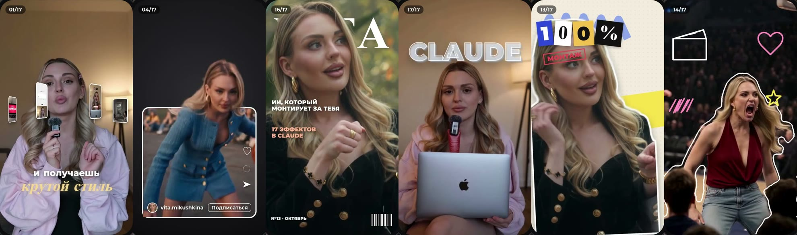

# Видеоэффекты для Claude от Виты

Кидаешь видео в Claude, пишешь `/effects` и название эффекта. Всё, монтаж готов.

Сделала [Вита Микушкина](https://instagram.com/vita.mikushkina) 🧡 · AI, нейросети и блогинг



## Установка (одна строка)

Открой Терминал (или терминал внутри Claude Code) и вставь:

```bash
git clone https://github.com/foremindai-prog/vita-video-effects ~/.claude/skills/effects
```

На Windows (PowerShell) вместо `~/.claude/skills/effects` пиши `$HOME\.claude\skills\effects`.

Потом перезапусти Claude Code. Готово.

> Не хочешь в терминал? Открой Claude Code и напиши: **«Установи скилл с github.com/foremindai-prog/vita-video-effects в папку ~/.claude/skills/effects»**. Claude всё сделает сам.

## Как пользоваться

1. Открой Claude Code (приложение или терминал).
2. Перетащи видео в чат.
3. Напиши, какой эффект нужен. Можно по-русски:

```
/effects orbit с 3 по 6 секунду
/effects backdrop-word на слове «смотри», слово МОНТАЖ за мной
/effects comment-box в конце, печатает СТУДИЯ
/effects glass-widgets первые 3 секунды
```

В первый раз Claude настроится сам (около 2 минут). Нужны ffmpeg и Python, если их нет, Claude их поставит.

Claude проверит несколько кадров, уберёт всё, что закрывает лицо, и сохранит `имя_видео_effects.mp4` рядом с оригиналом. Звук остаётся твой.

Эффекты можно ставить подряд одной фразой: *«locked-on с 6 по 10 секунду, потом orbit с 10 по 13, потом reject-stamp на слове „нет“»*.

## Русский текст

Все шрифты в паке поддерживают кириллицу, так что слова в эффектах можно писать по-русски: МОНТАЖ, СТУДИЯ, ВИТА.

## Эффекты

| # | Пиши | Что происходит |
|---|---|---|
| 1 | `orbit` | Твои рилсы летают вокруг головы, сверху уходят за тебя |
| 2 | `carousel-spin` | Рилсы крутятся вокруг тебя 3D-каруселью |
| 3 | `noise` | За головой вырастает стопка роликов |
| 4 | `phone-fan` | Рилсы раскрываются веером, как карты |
| 5 | `profile-wall` | Сетка рилсов на стене и растущий счётчик |
| 6 | `place-in-grid` | Ты в центре сетки профиля 3×3 с просмотрами |
| 7 | `locked-on` | Рамка защёлкивается на лице, камера едет за тобой |
| 8 | `lean-in` | Резкий наезд на одно слово |
| 9 | `slow-push` | Медленный наезд, комната уходит в размытие |
| 10 | `rabbit-hole` | Кадр проваливается сам в себя туннелем |
| 11 | `dot-reveal` | Кадр собирается из светящихся точек |
| 12 | `glitter-spotlight` | Свет гаснет, золотые лучи и слово за головой |
| 13 | `backdrop-word` | Огромное слово падает за тебя |
| 14 | `cover-star` | Ты на обложке журнала |
| 15 | `red-collage` | Чёрно-белая ты, красное слово сзади, три строки |
| 16 | `pastel-word` | Лавандовая комната, слово и карточка профиля |
| 17 | `led-sign` | Светящаяся неоновая вывеска за спиной |
| 18 | `match-cut` | Газетные страницы меняются на одном слове |
| 19 | `glass-widgets` | Стеклянные виджеты парят вокруг головы |
| 20 | `checklist` | Список задач Claude под подбородком, пункты зеленеют |
| 21 | `todo` | Чек-лист рядом с головой отмечается, пока говоришь |
| 22 | `apple-toggles` | Тумблеры iPhone включаются по одному |
| 23 | `messages` | Уведомления iMessage всплывают одно за другим |
| 24 | `liquid-glass-graph` | Стеклянная карточка с растущим графиком |
| 25 | `comment-box` | Комментарий Instagram сам печатается и отправляется |
| 26 | `tap` | Кнопка «Подписаться» переключается на «Вы подписаны» |

**Бонус, ещё 20:** `lineup`, `spotlight`, `the-bill`, `moody`, `swipe`, `pause-point`, `uninstall`, `reel-frame`, `shortcut-rain`, `reject-stamp`, `countdown-flip`, `scribble`, `split-headline`, `check-pills`, `timeline`, `headline-box`, `tier-list`, `broll-split`, `headline-wall`, `over-the-shoulder-zoom`.

Каждый эффект следит за лицом. Всё, что могло бы его закрыть, уходит за голову.

## Советы

- Лучше всего работают вертикальные видео с телефона, где ты в кадре.
- Время называй словами: «когда я говорю „смотри“». Claude сам найдёт секунду.
- Хочешь свои рилсы в `orbit`, `noise`, `phone-fan` или `profile-wall`? Дай Claude папку со скриншотами.
- В графиках, счётчиках и заголовках используй свои настоящие цифры.
- По умолчанию рендер в 1080p. Нужно 4K, так и напиши (будет дольше).

## Честно

- Это стартовые версии эффектов. В моих роликах тайминг и звук доведены руками.
- Claude делает черновик, ты утверждаешь. Посмотри результат перед публикацией.
- Звук и субтитры пак не добавляет, их доделай в CapCut или Edits.

## Если что-то пошло не так

Просто напиши Claude, что видишь: «слово закрывает лицо», «слишком быстро». Он поправит и отрендерит заново.

## Лицензии

Код: MIT, см. `LICENSE`. Отслеживание лица: [OpenCV YuNet](https://github.com/opencv/opencv_zoo) (MIT). Вырезание фона: [MediaPipe Selfie Segmenter](https://ai.google.dev/edge/mediapipe/solutions/vision/image_segmenter) (Apache 2.0). Шрифты Montserrat, Inter, Playfair Display, JetBrains Mono, Caveat и Oswald распространяются по SIL OFL, лицензии лежат в `fonts/`.
